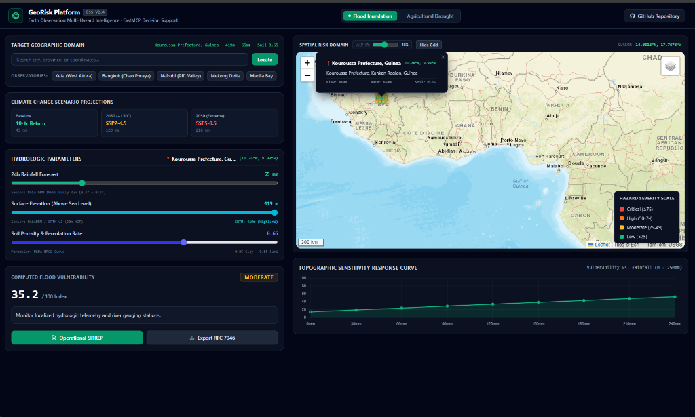
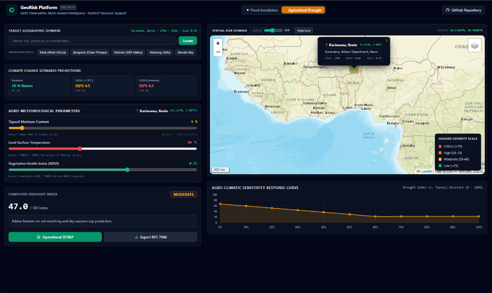

# GeoRisk Platform: Geospatial Climate Risk MCP Server & DSS

[](https://github.com/Huighlet/geospatial-risk-mcp-server/actions/workflows/ci.yml)
[](https://modelcontextprotocol.io)
[](https://www.python.org/)
[](LICENSE)

A production-grade Python **Model Context Protocol (MCP)** server and interactive decision-support platform providing deterministic geospatial analytics, multi-hazard risk indexing (Flood Inundation & Agricultural Drought), and RFC 7946 GeoJSON bounding-box hazard partitions for LLM agents, GIS analysts, and disaster response teams.

Engineered to support scientific, Earth-observation-grounded risk analytics adhering to the **UN Sendai Framework for Disaster Risk Reduction** and open geospatial decision-support standards.

---

## Interactive Decision Support Interfaces

### 1. Flood Inundation Intelligence

*Live Flood Inundation DSS over Kouroussa Prefecture, Guinea: Real-time SRTM v3 30m terrain elevation detection (419m), NASA GPM IMERG 24h precipitation synchronization (65mm), USDA-NRCS soil porosity curve (0.65), precision GIS reticle with reverse-geocoded place names, and topographic sensitivity response curve.*

### 2. Agricultural Drought Monitoring & Agro-Meteorology

*Live Agricultural Drought DSS over Karimama, Benin: NASA SMAP L4 topsoil moisture telemetry (6%), MODIS / VIIRS Terra-Aqua L3 thermal land surface temperature (30°C), Sentinel-2 MSI / MODIS NDVI vegetation health index (0.55), and dynamic agro-climatic sensitivity curve.*

---

## Key Architecture & Capabilities

### 1. Multi-Hazard Operational Decision Engine
- **Flood Inundation Engine:** Evaluates hydrodynamic vulnerability based on surface elevation (meters above sea level), 24-hour rainfall forecast (NASA GPM IMERG), and USDA-NRCS hydrologic soil porosity/percolation coefficients.
- **Agricultural Drought Engine:** Synthesizes root-zone topsoil moisture (NASA SMAP L4), land surface skin temperature (MODIS/VIIRS L3 thermal), and 16-day NDVI vegetation health composites into actionable agricultural advisory indices.
- **Climate Scenario Projections:** Provides contextual benchmarking across Baseline 10-Yr Return, 2030 (+1.5°C) SSP2-4.5, and 2050 Extreme SSP5-8.5 climate projections.

### 2. Physical Telemetry Auto-Detection & Reverse-Geocoding
- **One-Click Globe Sampling:** Clicking anywhere on the globe or selecting pre-configured observatories (Keta, Bangkok Chao Phraya, Nairobi Rift Valley, Mekong Delta, Manila Bay) queries high-resolution satellite APIs (Open-Meteo & SRTM).
- **Simultaneous 3-Slider Synchronization:** Automatically populates terrain elevation, local precipitation, and soil moisture/porosity for the exact clicked coordinates.
- **Human-Readable Place Names:** Reverse-geocodes raw lat/lon coordinates into administrative names in English (e.g., `Kouroussa Prefecture, Kankan Region, Guinea (11.26°N, 9.99°W)`) directly in the header and precision reticle popup.

### 3. Dynamic Sensitivity Response Modeling
- **Topographic Sensitivity Curves:** Dynamically models vulnerability trajectories across 0–240mm precipitation gradients to predict inundation tipping points.
- **Agro-Climatic Sensitivity Curves:** Graphs drought severity curves against topsoil moisture variations (0–100%) for dry-season crop protection and irrigation planning.

### 4. UN Sendai & OCHA-Aligned Operational SITREP Dispatch
- **Bounded Scientific Briefings:** Generates structured emergency situation reports (SITREPs) with incident tracking IDs (e.g., `SITREP-FL-0813`), operational phase banners, and physical sensor telemetry chips.
- **4-Sector Impact Matrices:** Evaluates specific vulnerabilities across Life Safety, Infrastructure/WASH, Transport Networks, and Agriculture/Food Security.
- **Phased Operational Timelines:** Establishes action directives from immediate warning (T-0h) through peak operational response (T-24h) to post-impact assessment (T-72h).
- **1-Click Export:** Copy formatted markdown dispatches directly to the clipboard or generate PDF-ready incident reports.

### 5. RFC 7946 GeoJSON Standard & Spatial Partitioning
- **Dynamic Bounding-Box Partitions:** Divides any target geographic area into analytical grid polygons with cell-specific elevation variance, computed risk scores, and centroid telemetry.
- **One-Click GIS Export:** Export generated hazard layers directly to `.geojson` for seamless ingestion into **QGIS**, **ArcGIS**, or **Google Earth Engine**.

### 6. Model Context Protocol (MCP) Native
- **FastMCP Protocol Integration:** Exposes standardized tool definitions, input schemas, and resource capabilities for Claude Desktop, Cursor, Antigravity, and autonomous agent loops.

---

## Registered MCP Tools

| Tool Name | Input Parameters | Output |
| :--- | :--- | :--- |
| **`calculate_flood_vulnerability`** | `latitude`, `longitude`, `elevation_meters`, `precipitation_mm`, `soil_absorption_rate` | Deterministic index (0 to 100), severity (`LOW` to `CRITICAL`), operational guidance |
| **`evaluate_drought_index`** | `soil_moisture_pct`, `surface_temp_celsius`, `baseline_ndvi` | Composite drought score, classification (`EXTREME_DROUGHT` to `NORMAL`) |
| **`query_bounding_box_risk`** | `min_lat`, `min_lon`, `max_lat`, `max_lon`, `hazard_type` | RFC 7946 GeoJSON FeatureCollection with analytical polygon coordinates |

---

## Project Structure

```text
geospatial-risk-mcp-server/
|-- server.py              # FastMCP server entrypoint & tool declarations
|-- web_app.py             # Interactive Leaflet Web Decision Support Dashboard
|-- models.py              # Pydantic data schemas & geographic validation
|-- services/
|   +-- risk_engine.py     # Deterministic mathematical & geospatial calculation engine
|-- tests/
|   +-- test_server.py     # Pytest suite verifying deterministic models & schemas
|-- assets/
|   |-- dashboard_preview.png  # Live simulation screenshot (Flood Inundation)
|   +-- drought_dss_preview.png # Live simulation screenshot (Agricultural Drought)
|-- .github/
|   +-- workflows/ci.yml   # GitHub Actions CI & Docker test automation
|-- Dockerfile             # Multi-stage container with automated test verification
|-- requirements.txt       # Dependency specifications
+-- README.md
```

---

## Quickstart

### 1. Launch the Interactive Web Dashboard
```bash
# Clone the repository
git clone https://github.com/Huighlet/geospatial-risk-mcp-server.git
cd geospatial-risk-mcp-server

# Create virtual environment and install dependencies
python -m venv .venv
source .venv/bin/activate  # Or on Windows: .\.venv\Scripts\activate
pip install -r requirements.txt

# Run the live map dashboard
python web_app.py
```
Access the live map interface at **`http://localhost:8000`** in your browser.

---

### 2. Connect to an MCP Client (Claude Desktop / Cursor)
Add to your `claude_desktop_config.json`:

```json
{
  "mcpServers": {
    "geospatial-risk": {
      "command": "python",
      "args": ["/path/to/geospatial-risk-mcp-server/server.py"]
    }
  }
}
```

---

### 3. Run Automated Tests
```bash
pytest tests/ -v
```

---

## License
MIT License
